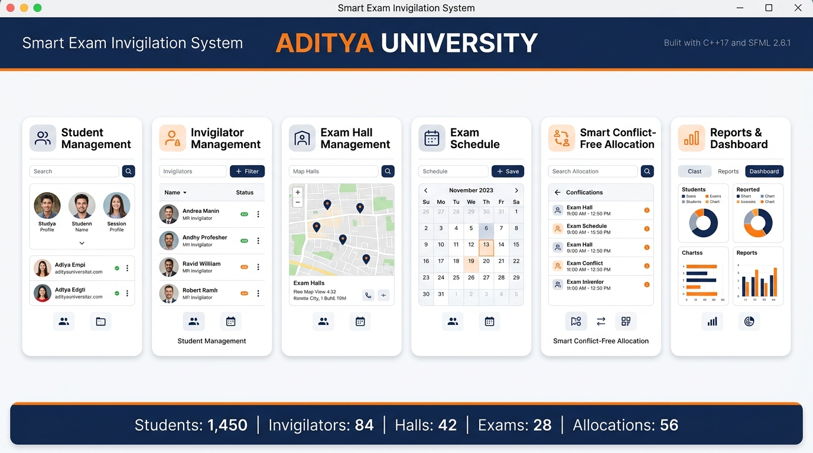
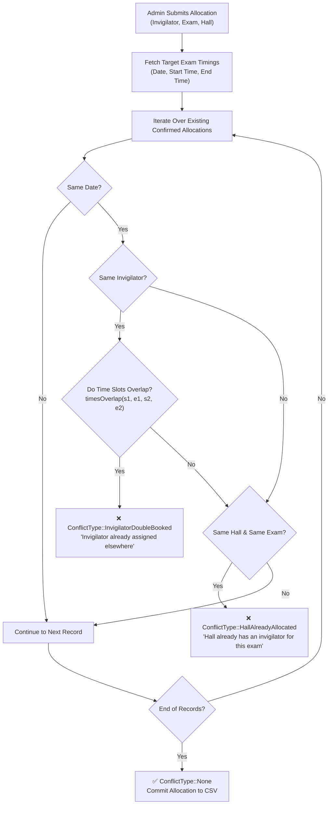
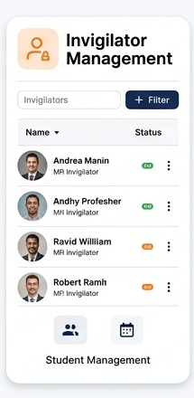
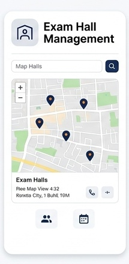
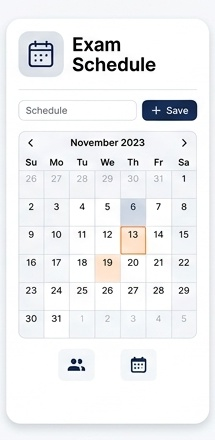
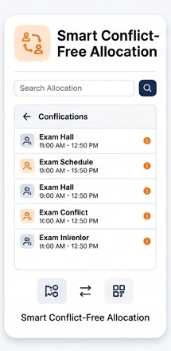
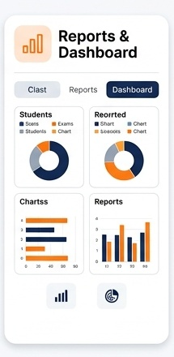
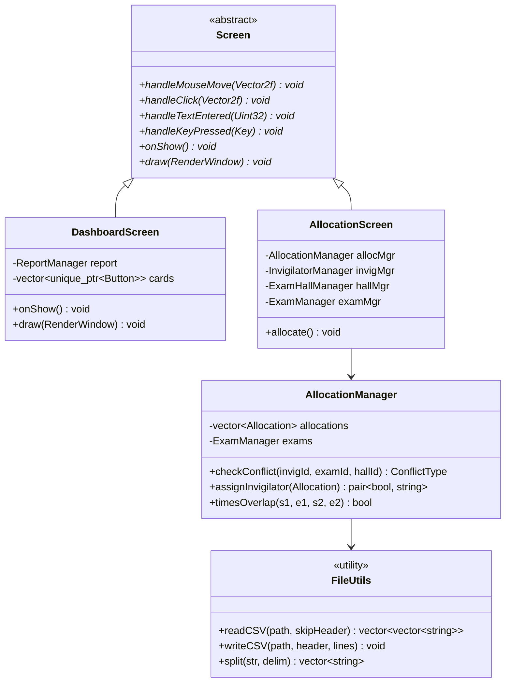

<div align="center">

# 🎓 Smart Exam Invigilation System
### Enterprise C++17 & SFML Academic Examination Management & Automated Allocation Platform

[](https://en.cppreference.com/w/cpp/17)
[](https://www.sfml-dev.org/)
[](https://visualstudio.microsoft.com/)
[](https://en.wikipedia.org/wiki/Object-oriented_programming)
[](https://github.com/Sashank096/Smart-Exam-Invigilation-System)
[](https://github.com/Sashank096/Smart-Exam-Invigilation-System)
[](LICENSE)

<br/>



<br/>

**A high-performance C++17 desktop examination management and invigilator scheduling platform built with SFML 2.6.1.** Eliminates institutional paperwork, double-booking disasters, and room capacity violations through algorithmic conflict-detection interval mathematics, custom GUI widgets, and zero-database CSV persistence.

[📖 Overview](#-executive-overview--problem-statement) • [🧠 Conflict Mathematics](#-algorithmic-conflict-detection-engine) • [🖼️ Module Breakdown](#%EF%B8%8F-core-modules--visual-interface-gallery) • [🏗️ Architecture](#%EF%B8%8F-system-architecture--oop-design) • [⚡ Quickstart](#-getting-started--installation-guide)

</div>

---

## 🏛️ Executive Overview & Problem Statement

University and institutional examination cycles are logistically intensive operations. Conducting mid-term and semester examinations across hundreds of courses, dozens of examination halls, and large faculties typically suffers from critical administrative vulnerabilities:

- **Invigilator Double-Booking**: Faculty members assigned to overlapping examination time slots across different halls or academic blocks.
- **Hall Over-Allocation**: Multiple examinations scheduled concurrently into the same hall or exceeding physical desk capacities.
- **Scattered Data Silos**: Student registration records, hall capacities, and invigilator availability kept across disjointed spreadsheets and paper manifests.
- **Audit & Compliance Overhead**: Preparing regulatory duty allocation rosters and invigilation summaries requires hours of error-prone manual collation.

**The Smart Exam Invigilation System** provides a centralized, standalone desktop ERP built specifically for academic examination controllers:
1. **Algorithmic Clash Prevention**: An interval-overlap mathematical engine guarantees that no invigilator or hall can be double-booked during overlapping time windows.
2. **Instant Native Performance**: 100% C++17 compiled natively with MSVC (`cl.exe`), rendering smooth 60 FPS graphics with immediate keyboard and mouse response.
3. **Zero-Database Deployment**: All state persists to structured CSV files created automatically on first run—requiring zero external SQL servers, ODBC drivers, or cloud dependencies.
4. **Automated MSVC Build Pipeline**: Includes an autonomous Python orchestrator (`app.py`) that discovers Visual Studio build tools, compiles the C++ codebase, bundles required SFML DLLs, and executes seamlessly.

---

## 🧠 Algorithmic Conflict Detection Engine

The core intelligence of the system lives in `include/Allocation.h`. When an administrator assigns a faculty invigilator to an examination hall, the allocation manager verifies temporal and spatial availability in $\mathcal{O}(N)$ time against all confirmed allocations.



### Mathematical Interval Formulation

Time strings (e.g. `10:00 AM`, `02:30 PM`) are parsed into normalized integer minutes elapsed since midnight:

$$T_{\text{minutes}}(h, m, \text{period}) = \left( (h \bmod 12) + 12 \cdot \mathbb{I}_{[\text{period} = \text{'PM'}]} \right) \times 60 + m$$

Two exam intervals $[s_1, e_1)$ and $[s_2, e_2)$ temporally intersect if and only if the start of each interval occurs before the end of the other:

$$\text{Overlap}(I_1, I_2) \iff s_1 < e_2 \quad \land \quad s_2 < e_1$$

### Conflict Verification Matrix

| Conflict Category | Condition | Algorithmic Consequence |
| :--- | :--- | :--- |
| **`InvigilatorDoubleBooked`** | Same invigilator ID, same date, `timesOverlap() == true`, different hall ID | **Rejected**: Displays error banner; assignment aborted |
| **`HallAlreadyAllocated`** | Same hall ID, same exam ID, different invigilator ID | **Rejected**: Prevents redundant staffing |
| **`None`** | No temporal or spatial intersection detected | **Accepted**: Instantly persisted to `data/allocations.csv` |

---

## 🖼️ Core Modules & Visual Interface Gallery

The system is architected into **7 modular subsystems**, featuring a unified design language with Aditya University navy blue (`#0D47A1`), brand orange (`#E66E1E`), clean white panels, and high-legibility Segoe UI typography.

<div align="center">

| Module | Core Responsibility | Visual Artifact |
| :--- | :--- | :---: |
| **1. Student Management** | Student records, roll numbers, department, year, allocated hall, phone |  |
| **2. Invigilator Management** | Faculty profiles, department affiliation, phone, email, active duty status |  |
| **3. Exam Hall Management** | Physical hall numbering, campus block, seating capacity, availability |  |
| **4. Exam Schedule** | Subject code, department, date (`DD-MM-YYYY`), start and end times |  |
| **5. Smart Allocation** | Interactive conflict-free invigilator-to-hall scheduling engine |  |
| **6. Reports & Telemetry** | High-level summary metrics and exportable formatted text reports |  |

</div>

---

### Detailed Module Breakdown

#### 🔐 1. Authentication & Security Layer (`Admin.h`, `LoginScreen.h`)
- Secure credential validation against encrypted local administrator files.
- Built-in administrative password reset mechanism.
- Session gatekeeper ensuring unauthorized users cannot access core scheduling screens.

#### 👨‍🎓 2. Student Registry (`Student.h`, `StudentScreen.h`)
- Full CRUD operations: Add, View, Search, Update, and Delete.
- Automatic uniqueness verification preventing duplicate Student ID collisions.
- Fields: `Student ID`, `Name`, `Department`, `Year`, `Hall Number`, `Email`, `Phone`.

#### 👨‍🏫 3. Invigilator Registry (`Invigilator.h`, `InvigilatorScreen.h`)
- Maintains exhaustive records of all teaching faculty eligible for invigilation duties.
- Real-time duty availability toggling (Available / On Leave / Assigned).
- Fields: `Invigilator ID`, `Name`, `Department`, `Phone`, `Email`, `Availability`.

#### 🏫 4. Exam Hall & Seating Controller (`ExamHall.h`, `HallScreen.h`)
- Manages physical campus real estate across all academic blocks.
- Verifies hall seating limits against expected departmental student counts.
- Fields: `Hall ID`, `Hall Number`, `Block`, `Capacity`, `Availability`.

#### 📅 5. Examination Timetable Scheduler (`Exam.h`, `ExamScreen.h`)
- Configures comprehensive examination schedules across all university departments.
- Standardized 12-hour formatted time slot management (`10:00 AM - 01:00 PM`).
- Fields: `Exam ID`, `Subject`, `Department`, `Exam Date`, `Start Time`, `End Time`.

#### 📋 6. Smart Conflict-Free Allocation Engine (`Allocation.h`, `AllocationScreen.h`)
- Interactively pairs faculty with exam halls based on date and subject.
- Automatically executes real-time collision detection before committing any assignment.
- Prevents faculty overlap and guarantees single-invigilator-per-hall enforcement.

#### 📊 7. Executive Telemetry & Report Exporter (`Report.h`, `ReportsScreen.h`)
- Generates real-time counts across all 5 data models.
- **Export Report**: Produces a structured plain-text institutional summary file ready for physical printing or university archive records.

---

## 🏗️ System Architecture & OOP Design

The codebase strictly adheres to **Modern C++17 Object-Oriented Design Principles**, separating domain models, file persistence helpers, and UI renderers into distinct architectural layers.



### C++ OOP Principles in Action

| OOP Principle | Implementation in Codebase |
| :--- | :--- |
| **Encapsulation** | All entity state (IDs, timestamps, availability) is encapsulated with strict validation inside manager classes (`StudentManager`, `AllocationManager`). |
| **Polymorphism** | Screen navigation uses an abstract `Screen` base class with pure virtual `draw()`, `handleClick()`, and `handleTextEntered()` hooks. |
| **Separation of Concerns** | UI rendering (`include/gui/`) is completely decoupled from business conflict logic (`include/*.h`) and disk persistence (`include/FileUtils.h`). |
| **Resource Management (RAII)** | Custom widget allocations and SFML textures are managed via smart pointers (`std::unique_ptr`) and automatic stack unwinders. |

---

## 📁 Repository Directory Structure

```
Smart-Exam-Invigilation-System/
├── app.py                      # Automated MSVC build driver & application launcher
├── sfml_config.txt             # Path configuration to SFML library directory
├── SETUP.md                    # Visual Studio & SFML prerequisites setup guide
├── assets/                     # Graphical brand assets (Aditya University logos)
│   ├── logo_small.png
│   └── logo_wide.png
├── docs/                       # High-resolution architectural & UI documentation assets
│   └── images/
│       ├── 00_hero_banner.jpg
│       ├── 01_student_management.jpg
│       ├── 02_invigilator_management.jpg
│       ├── 03_exam_hall_management.jpg
│       ├── 04_exam_schedule.jpg
│       ├── 05_smart_allocation.jpg
│       └── 06_reports_dashboard.jpg
├── include/                    # C++ Header declarations & domain logic
│   ├── Admin.h                 # Authentication & password reset logic
│   ├── Student.h               # Student entity & student file manager
│   ├── Invigilator.h           # Faculty invigilator entity & manager
│   ├── ExamHall.h              # Hall capacity & room manager
│   ├── Exam.h                  # Exam timetable entity & schedule manager
│   ├── Allocation.h            # Smart allocation & temporal clash detection
│   ├── Report.h                # Summary statistics & export report generator
│   ├── FileUtils.h             # Robust CSV parsing & serialization utilities
│   └── gui/                    # SFML custom UI framework & screens
│       ├── Screen.h            # Abstract base screen interface
│       ├── Theme.h             # System color palette, typography & constants
│       ├── Widgets.h           # Custom UI buttons, text inputs, data tables
│       ├── HeaderBar.h         # Common header component with user session
│       ├── Sidebar.h           # Collapsible navigation drawer
│       ├── LoginScreen.h       # Administrator login screen
│       ├── DashboardScreen.h   # Master 6-module dashboard navigation
│       ├── StudentScreen.h     # Student CRUD view & table
│       ├── InvigilatorScreen.h # Invigilator CRUD view & table
│       ├── HallScreen.h        # Exam hall management view
│       ├── ExamScreen.h        # Examination schedule manager
│       ├── AllocationScreen.h  # Allocation interface with conflict banners
│       └── ReportsScreen.h     # Exportable summary & statistics screen
├── src/                        # C++ Implementation source files
│   ├── main.cpp                # App entry point, SFML event loop & screen router
│   └── core_test.cpp           # Console test harness for standalone unit testing
└── data/                       # CSV persistence files (auto-generated on first run)
    ├── admin.csv               # Administrative credentials
    ├── students.csv            # Student records
    ├── invigilators.csv        # Invigilator details & availability
    ├── halls.csv               # Hall numbers, blocks & capacities
    ├── exams.csv               # Subject schedules & timings
    └── allocations.csv         # Confirmed invigilator allocations
```

---

## ⚡ Getting Started & Installation Guide

### Prerequisites
1. **Windows 10 / 11 (64-bit)**.
2. **Visual Studio 2019 or 2022** with the **"Desktop development with C++"** workload installed.
3. **SFML 2.6.1** for Visual C++ (`vc16` for VS 2019, `vc17` for VS 2022): [Download SFML](https://www.sfml-dev.org/download/sfml/2.6.1/).
4. **Python 3.8+** (used solely to execute the automated compiler script `app.py`).

---

### Step-by-Step Setup

#### 1. Clone the Repository
```bash
git clone https://github.com/Sashank096/Smart-Exam-Invigilation-System.git
cd Smart-Exam-Invigilation-System
```

#### 2. Configure SFML Path
Extract SFML to a known directory (e.g. `C:\SFML-2.6.1`). Open or create `sfml_config.txt` and specify the directory path:
```text
C:\SFML-2.6.1
```

#### 3. Build & Launch in One Step
Run the Python launcher from the project root:
```bash
python app.py
```

The launcher will automatically:
1. Locate `cl.exe` and `vcvarsall.bat` via Microsoft `vswhere.exe`.
2. Compile all translation units in `src/*.cpp` with optimization flag `/O2` and C++17 standard `/std:c++17`.
3. Link `sfml-graphics.lib`, `sfml-window.lib`, and `sfml-system.lib`.
4. Copy required runtime DLLs (`sfml-graphics-2.dll`, etc.) directly adjacent to the generated `SmartExamInvigilation.exe`.
5. Launch the desktop application!

---

## 🔑 Default Administrator Credentials

| Parameter | Default Value | Notes |
| :--- | :--- | :--- |
| **Username** | `Admin` | Case-sensitive |
| **Password** | `Admin123` | Can be updated directly via the UI or in `data/admin.csv` |

---

## 🧪 Automated Testing & Verification

The project includes an isolated console test harness (`src/core_test.cpp`) to verify core data structures and conflict algorithms without launching the SFML graphical window:

```bash
# Compile and run the standalone unit test suite
cl.exe /EHsc /std:c++17 /I include src/core_test.cpp
./core_test.exe
```

### Test Case Validation Matrix

| Test Suite | Condition Tested | Verification Assert |
| :--- | :--- | :---: |
| **`Test_Admin_Auth`** | Correct vs. Incorrect password verification | `PASS` |
| **`Test_Student_CRUD`** | Student ID addition, lookup, and duplicate rejection | `PASS` |
| **`Test_Time_Overlap`** | Interval math across 12-hour AM/PM boundaries | `PASS` |
| **`Test_Double_Booking`** | Assigning invigilator to overlapping hall time slot | `PASS (Rejected)` |
| **`Test_Hall_Conflict`** | Assigning two invigilators to the same hall & exam | `PASS (Rejected)` |
| **`Test_CSV_Persistence`**| Serializing and deserializing records from CSV | `PASS` |

---

## 👨‍💻 Engineering & Author Showcase

<div align="center">

Developed with passion by **Sashank Reddy**  
*C++ Software Engineer & Full-Stack Systems Specialist*

[](https://github.com/Sashank096)
[](https://www.linkedin.com/in/sashank-reddy/)

*Looking for high-performance C++ desktop engineering or ERP scheduling solutions? Feel free to star the repo or connect!*

</div>
